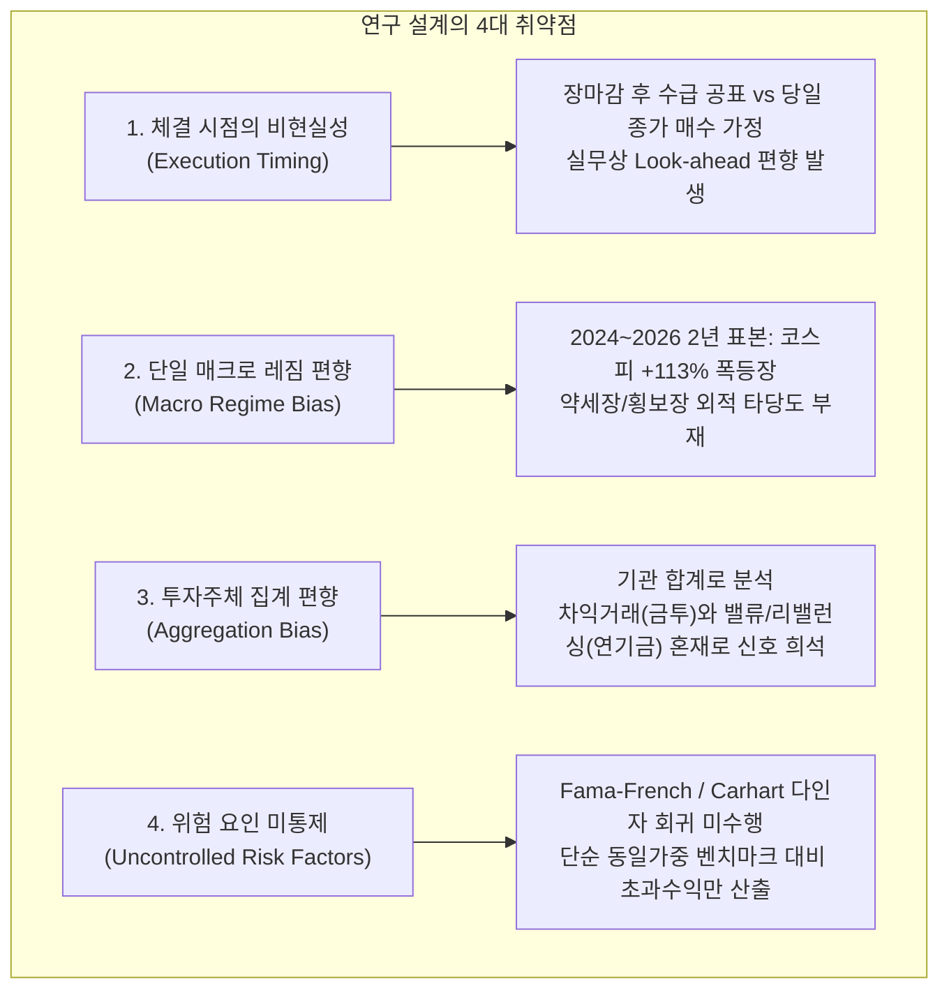

# [지도교수 평가서] 투자주체 수급 백테스트 및 리스크관리 연구 이해도 점검 및 방법론 비판

- **수신:** 연구원 (학생)
- **발신:** 지도교수
- **평가 대상 문서:** 
  1. [`투자주체_수급_백테스트_보고서.md`](file:///c:/Users/mrsim/trading-strategies/strategy1/투자주체_수급_백테스트_보고서.md)
  2. [`리스크관리_분석_보고서.md`](file:///c:/Users/mrsim/trading-strategies/strategy1/리스크관리_분석_보고서.md)
- **작성일:** 2026-10-27

---

## 1. 총평: 계량적 직관은 합격점이나, 통계 방법론과 리스크 관리 분석에서 치명적 오독 존재

제출한 이해도 정리 내용을 면밀히 검토했다. 

결론부터 냉정하게 말하겠다. **실무적 결론(당일 가격 충격 소진, 비용 차감 후 알파 부재, 외국인 순매도의 유의성)에 대한 거시적 직관은 양호하다. 그러나 계량경제학적 검정 방법론(t검정 표본 단위, 시계열 자기상관 보정, 표본 부족 구간)에 대해 중대한 오해를 하고 있으며, 리스크 관리 보고서의 핵심 기여(꼬리 위험, 거시 수급 지수 예측력 부재, U자형 수급의 거래규모 효과)를 누락하거나 정반대로 해석(중간 분위 매집설 등)했다.**

학위 논문 프로포절이나 퀀트 리서치 페이퍼 디펜스 관점에서 평가하자면 현재 이해도는 **B0 (보통)** 수준이다. 아래 세부 조항별 팩트체크와 연구 설계상의 취약점을 반드시 정독하고 수정·보완하기 바란다.

---

## 2. 제출한 이해 내용 1:1 정밀 피드백 (Fact Check & Rebuttal)

| 번호 | 학생의 이해 요약 | 판정 | 지도교수 상세 코멘트 |
|---|---|:---:|---|
| **1-1** | 기관/외인/개인 순매수 강도 측정 목적: 다음날 따라 사서 1~240일, 2년 보유 시 수익률 및 통계적 유의성 확인 | **부분 수정** | 목적의 절반만 파악함. **추종 전략(H1)**뿐만 아니라, 기관/외인의 비정보성 매도(펀드 환매, 리밸런싱 등)로 인한 일시적 가격 하락을 노리는 **저점 매수/반등 전략(H2)** 검증이 대등한 축이었음. 또한 매수 시점 가정이 "다음날"이 아니라 **"신호 당일 종가 매수"**로 설정된 비현실성을 짚어내지 못함. |
| **1-2** | 코스피·코스닥 전 종목 대상 (스팩 등 일정 기준 이하 제외) | **정확 (보완 필요)** | 유니버스 필터(거래정지, 시총 500억 미만, 스팩, 우선주, 리츠 제외)는 맞음. 다만 **분석 ①(상위 50 종목)은 이 필터가 미적용**되었고 분석 ②·③에서 정식 적용되었다는 방법론적 진화 과정을 명시해야 함. 또한 **상장폐지 171개 종목 스냅샷을 포함하여 생존편향(Survivorship Bias)을 제거**했다는 점을 함께 서술해야 함. |
| **1-3** | 기간: 2024~2026년 | **정확 (한계 인지 필요)** | 2024-10-22 ~ 2026-10-22 (487 영업일)로 팩트는 정확함. 그러나 학술적으로 이 기간은 **KOSPI가 +113% 폭등하고 KOSDAQ은 +2.5%에 그친 극단적인 대형주 강세 단일 레짐(Single Regime)**이라는 점을 비판적 시각으로 인식하고 있어야 함. |
| **2** | 순매수 강도 = 당일 순매수거래대금 / 당일 시가총액 (규모효과 최소화) | **정확** | 완벽히 이해함. 금액($N$) 기준 순위는 사실상 대형주 시가총액 순위가 되어 240일 초과수익률이 +30~40%로 왜곡되는 '규모 효과'를 유발했기에 비율($x$)로 정규화함. (단, 비율로 정규화해도 '거래 활발도' 효과가 남는다는 점은 9번 피드백 참고). |
| **3** | 순매수 강도 기준 10분위 구분 (1분위: 강한 순매도, 10분위: 강한 순매수) | **정확** | 정확함. 날짜별, 시장(코스피/코스닥)별, 투자주체별로 $x$ 기준 10분위로 횡단면 정렬함. |
| **4** | 10개 분위 전부에 1주씩 투자했다고 가정 | **치명적 오류** | **완전히 틀렸다.** 1주씩 사는 것은 **가격가중(Price-weighted)**으로, 주가가 비싼 종목(예: 삼성전자 1주 vs 소형주 1주)에 왜곡된 가중치가 부여된다. 본 연구는 모든 종목을 동일한 금액 비율로 매수하는 **동일가중(Equal-weighted)** 방식을 취하고 있으며, 벤치마크 또한 유니버스 동일가중 평균이다. |
| **5-1** | 비용 제외 시 초과수익 없음, 초과수익은 시장수익률 초과분 | **정확** | 용어 정리: '비용을 제외했을 때'는 '왕복 거래비용(0.25%)을 차감한 후(Net of costs)'를 의미하며, 초과수익률은 동일 시장 벤치마크 대비 초과수익($e^h_{s,d}$)을 의미함. 팩트 정확. |
| **5-2** | 1~60일 보유 시 각 보유기간별 평균수익률에 대해 t검정 수행 | **치명적 통계 오독** | **계량경제학적 핵심을 완전히 오해함.** "개별 주식 매수 수익률"에 대해 t검정을 한 것이 아님. 개별 주식들은 시장 충격을 공유하므로 횡단면 독립성이 깨진다. 따라서 **날짜별 포트폴리오 초과수익률 시계열($P^h_{g,d}$)**을 하나의 표본으로 묶어 검정했다. 또한 보유기간이 겹치는 오버랩핑 문제($h-1$일 겹침)로 인해 일반 t검정이 아니라 **Newey-West HAC(이분산 및 자기상관 일치) t검정**을 수행함. (일반 t를 쓰면 t=15로 뻥튀기되나 Newey-West는 t=1.6으로 정상화됨). |
| **5-3** | 120일, 240일, 2년 보유 시 전체 평균 수익률에 대해 t검정 수행 | **완전한 오류** | **정반대로 알고 있음. 120일 이상은 t검정을 "수행하지 않았다".** 487일 표본에서 240일 비중첩 기간은 고작 1~2개뿐이라 표준오차 추정이 수학적으로 불가능하다. 보고서 4.6절에 명시되었듯, 120일 이상의 숫자는 통계 검정 대상이 아니라 특정 장세의 **단일 관측 사례(Single Historical Case)**로만 기록했을 뿐이다. |
| **6** | 외국인 순매수 강도 약함(순매도 강함) 시 향후 하락 신호 여부 | **정확 (방향성 확인)** | 맞다. 외국인은 세 주체 중 유일하게 **유의한 정보(Information) 신호**를 가졌다. 외국인이 강하게 판 종목은 20일 셀 대비 -0.21%(t -3.4), 시장 대비 비용 후 -0.46%(t -7.5)로 지속 하락했다. 특히 리스크 보고서 3부에서 **20일 내 -20% 이상 급락할 확률이 대조군 대비 +0.8~1.0%p(t 4.8~5.6) 유의하게 높음**이 증명됨. 즉, "저점 매수"가 아니라 **"반드시 피해야 할 위험 신호"**다. |
| **7** | 하루 뒤 따라 사는 걸로는 1~10분위 전부 초과수익 불가 | **정확** | 팩트 정확함. 단기(1일)는 왕복 수수료(0.25%)가 하루 초과수익(0.1%)을 압도하여 전 분위 유의한 손실이며, 5~60일 역시 비용 차감 후 알파는 통계적으로 기각됨. |
| **8** | 당일 수급 정보는 당일 트레이딩으로 종결, 당일 가격에 다 반영됨 | **정확 (핵심 관통)** | 본 연구의 가장 중요한 경제학적 발견이다. 기관 순매수 상위 50 종목은 당일에 이미 +2.71%, 외인은 +2.06%, 개인 순매도 종목은 +3.45% 급등한다. 장 마감 후 공개되는 수급을 보고 다음날 진입하는 투자자는 **"이미 가격 충격(Price Impact)이 다 끝난 상투"**에 진입하는 꼴이다. |
| **9** | 중간 분위수(4~6분위)는 매집 가능성이 있으나 유의한 결론 없음 | **치명적 오독 / 근거 없는 추정** | **보고서 내용을 완전히 거꾸로 해석함.** 보고서 어디에도 "중간 분위수가 매집"이라는 결론은 없다. 보고서의 실체는 **기관 수급의 "U자형 패턴"**이다. 양 끝(1분위 순매도, 10분위 순매수)이 오르고 중간(4~6분위)이 -1.9~-2.5%로 폭락했다. 이는 매집이 아니라 **기관의 거래규모(Activity) 효과**였다. 기관이 활발히 거래한 종목은 사든 팔든 강했고, 기관이 손대지 않은 소외주(중간 분위)가 부진했던 것이다. ("누적 매집"은 8장 후속 과제 아이디어일 뿐임). |

---

## 3. 학생이 완전히 놓친 핵심 분석 내용 (Critical Omissions)

두 편의 보고서를 읽고도 아래 세 가지 핵심 기여를 정리에서 완전히 누락했다. 이는 보고서의 학술적 가치의 50% 이상을 간과한 것이다.

### (1) 리스크 관리 2부: 시장 전체 거시 수급 지표와 지수 예측력의 완전한 부재
- **연구 질문:** "오늘 시장 전체에서 외국인이 대규모 순매도를 기록했다면, 내일 이후 KOSPI/KOSDAQ 지수가 하락하므로 주식 비중을 줄여야 하는가?" (Macro Timing / Asset Allocation)
- **분석 결과:** 당일 지수와 당일 수급의 동행 상관계수는 매우 높다 (KOSPI 외인 +0.56, 개인 -0.69). 그러나 **익일 이후 지수 수익률을 예측하는 회귀계수 $b$는 모든 주체·보유기간에서 통계적으로 0(유의성 전무)**이었다.
- **결론:** 시장 수급 데이터로 거시적 자산배분(주식 익스포저 조절)을 하겠다는 전략은 학술적·통계적 근거가 전혀 없는 허상이다.

### (2) 리스크 관리 3부: 꼬리 위험(Tail Risk, 급락 확률)과 '손바뀜' 리스크
- **평균 수익률 분석의 한계 극복:** 평균 초과수익률 차이가 0.2%p에 불과하더라도, 포트폴리오를 파괴하는 것은 **-20% 이하의 급락(Tail Risk)**이다.
- **통제 분석의 엄밀성:** 극단적 수급 종목은 원래 변동성이 큰 종목이 몰린다. 따라서 단순 비교가 아니라 **'시가총액 3구간 × 과거 20일 변동성 5구간(총 15개 셀)'을 통제**한 후 순수한 수급 충격의 급락 확률을 측정했다.
- **핵심 발견:**
  1. 수급이 극단적인 종목은 방향과 무관하게 변동성 통제 후에도 급락 확률이 1.1~1.3배 높다 (변동성 군집).
  2. 그 위에 **방향성 효과**가 얹힌다. **외국인 순매도 종목은 순매수 종목 대비 20일 내 -20% 이상 폭락할 확률이 +0.8~1.0%p(t 4.8~5.6) 유의하게 높다.**
  3. 특히 **외국인이 투매하고 개인이 받아낸 종목(손바뀜 신호)**은 20일 최저 -20% 도달 확률이 21.4%에 달한다.

### (3) 개인 투자자의 '역지표(Contrarian Indicator)' 특성
- 개인 순매수 10분위 종목은 1~5일 단기에서 일관되게 음(-)의 초과수익률을 기록하며, IC 역시 유의한 음수(-0.015, t=-4.3)를 보였다.
- 꼬리 위험 분석에서도 개인 대량 순매수 종목은 개인 순매도 종목 대비 급락 확률이 +0.5~0.8%p 유의하게 높았다.
- 즉, 개인 수급은 추종 대상이 아니라 명백한 **역방향(Contrarian) 경계 신호**다.

---

## 4. 연구 설계 및 계량 방법론 비판 (지도교수 관점의 한계 지적)

만약 자네가 이 보고서를 바탕으로 석사 학위 논문이나 학술지 투고를 준비한다면, 심사위원들로부터 다음과 같은 가혹한 공격을 받게 될 것이다. 연구 설계상의 구조적 결함을 짚어줄 테니 반드시 숙지하라.

### (1) 진입 시점과 실행 가능성의 치명적 괴리 (Look-ahead Bias)
- **설계 결함:** 백테스트는 $d$일 장 마감 후 확정된 순매수 데이터를 보고 **"$d$일 종가에 진입한다"**고 가정했다.
- **실무적 현실:** KRX의 일별 투자자별 순매수 확정 집계는 15:30 장 종료 후(잠정치는 16시경, 최종 확정치는 18시경)에 산출된다. 따라서 장 마감 동시호가(15:20~15:30)에 확정 수급을 알고 종가에 체결시키는 것은 **물리적으로 불가능(Look-ahead)**하다.
- **방법론적 수정 요구:** 실제 거래 가능한 시점인 **$d+1$일 시가(Open) 진입**으로 백테스트를 재설계해야 한다. 당일 급등 종목은 익일 시가 갭상승(Gap-up)이 발생하므로, 익일 시가 매수를 적용하면 보고된 수익률보다 훨씬 더 처참한 결과가 나올 것이다.

### (2) 단일 거시 레짐 편향 (Sample Period & External Validity)
- **설계 결함:** 2024.10 ~ 2026.10 (487영업일)은 코스피가 2배 이상 오른 유례없는 대형주 불장이다. 
- **문제점:** 
  - 120일~240일 초과수익률이 대형주 위주로 +30~40% 나온 것은 수급의 힘이 아니라 지수 랠리의 베타(Beta) 효과다.
  - 기관 순매도 종목의 미세한 반등(+0.3%)이나 외국인 순매도의 꼬리 위험이 **하락장(Bear Market)이나 박스피(Range-bound Market)에서도 동일하게 작동할 것인가?** 외적 타당도(External Validity)가 심각하게 결여되어 있다. 최소 2018~2026년(8개년, 코로나 급락 및 인플레이션 금리인상기 포함)으로 표본을 확장해야 한다.

### (3) 기관 투자자의 집계 편향 (Aggregation Bias)
- **설계 결함:** '기관합계'라는 단일 범주로 묶어 분석했다.
- **문제점:** 
  - **금융투자:** ETF 유동성 공급(LP), 선물-현물 무위험 차익거래, ELS 델타 헤징 등 초단기 기계적 물량이 대부분이다. 정보성이 전혀 없다.
  - **연기금:** 자산배분 규정에 따른 기계적 리밸런싱 매도와 벤치마크 추종 매수가 주를 이룬다.
  - **투신/사모:** 액티브 펀드매니저의 개별 종목 발굴(Stock Picking) 알파가 반영된다.
  - 이질적인 세 집단을 하나로 합쳐놓았으니, 기관 신호에서 유의미한 방향성이 상쇄되어 '거래규모 효과(U자형)' 외에는 남지 않는 것은 당연한 귀결이다.

### (4) 자산가격결정 다인자 모형(Multi-Factor Model) 통제의 부재
- **설계 결함:** 본 연구는 시장 벤치마크 초과수익($e = R - B$)과 단순 시총 3분위 셀 통제에 머물렀다.
- **학술적 표준:** 금융공학 및 재무경제학 학술 논문에서는 Fama-French 3-Factor (시장, 크기, 밸류) 또는 Carhart 4-Factor (+모멘텀) 횡단면 회귀(Fama-MacBeth Regression)를 통해 알파($\alpha$)를 분리해야 한다. 기관/외인이 매수한 종목이 단순히 '과거 모멘텀이 높았던 주식'이어서 오른 것인지, 수급 자체의 순수한 알파인지를 통계적으로 증명하지 못했다.

---

## 5. 최종 결론 및 권고사항 (지도교수 처방)

### 핵심 요약 표: 학생의 직관 vs 학술적 실체

| 구분 | 학생의 기존 이해 | 학술적 팩트 및 정정 |
|---|---|---|
| **연구의 핵심 가치** | "순매수 따라 사서 알파를 내는 전략 백테스트" | **"알파 창출 실패 규명 및 꼬리 위험(다운사이드) 방어 도구로의 전환"** |
| **통계 검정** | "개별 종목들에 대해 일반 t검정 수행" | **"날짜별 포트폴리오 시계열에 대한 Newey-West HAC 보정 검정"** |
| **장기(120일+) 수익률** | "장기 보유 시 전체 평균 수익률 검정" | **"표본 부족으로 검정 불가(단일 역사적 사례로 취급)"** |
| **기관 중간 분위수** | "중간 분위수는 매집의 가능성이 있음" | **"매집 아님. 기관 거래 활발도에 따른 U자형 거래규모 효과"** |
| **외국인 순매도** | "외인 순매도 종목은 추가 하락함 (확신 부족)" | **"확실함. 정보성 매도로 익일 부진 및 급락 확률(+1%p) 유의적 급증"** |
| **거시 지수 수급** | (언급 없음, 누락) | **"시장 전체 수급은 당일 동행할 뿐 익일 지수 예측력 0% (자산배분 불가)"** |

### 지도교수의 향후 연구 지시
1. **용어와 방법론의 엄밀화:** 보고서를 인용하거나 요약할 때 "1주씩 투자", "개별 주식 t검정" 같은 치명적인 기본기 오류를 다시는 범하지 않도록 계량 기본 개념(동일가중, Newey-West)을 철저히 복습할 것.
2. **리스크 관리 관점의 내재화:** 수급 데이터는 '수익을 내는 창'이 아니라 **'지뢰를 피하는 방패'**다. 외국인 대량 순매도 + 개인 대량 순매수 종목을 포트폴리오에서 즉시 비중 축소하거나 매수를 유예하는 리스크 필터 알고리즘으로 발전시킬 것.
3. **진입 시점 수정 백테스트:** $d$일 종가가 아닌 $d+1$일 시가 진입 코드를 작성하여 실무적 슬리피지를 반영한 정밀 백테스트 결과를 차주 세미나 전까지 제출할 것.
